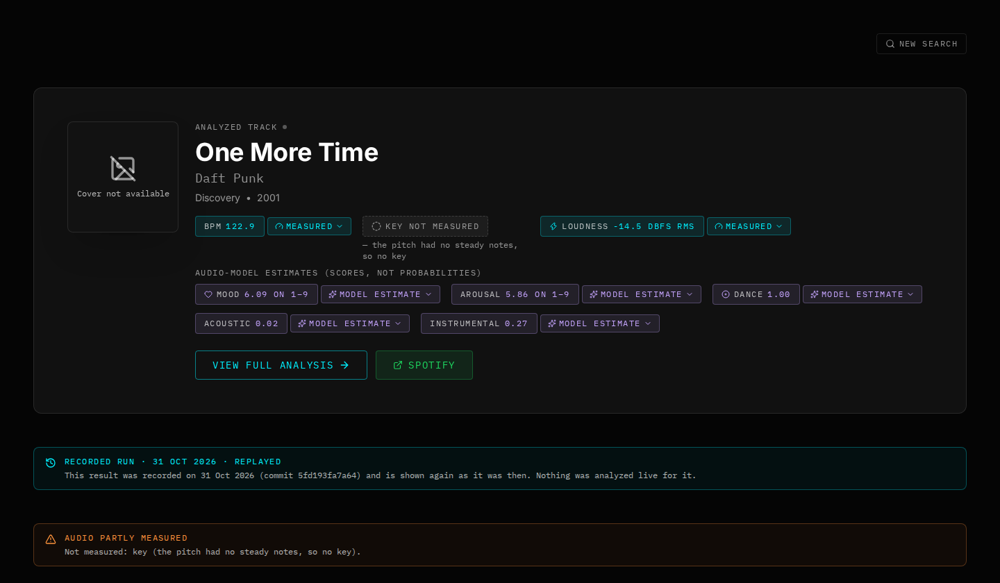
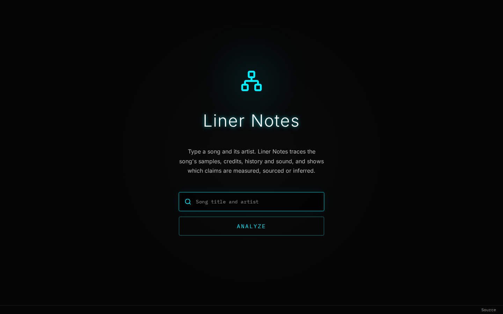
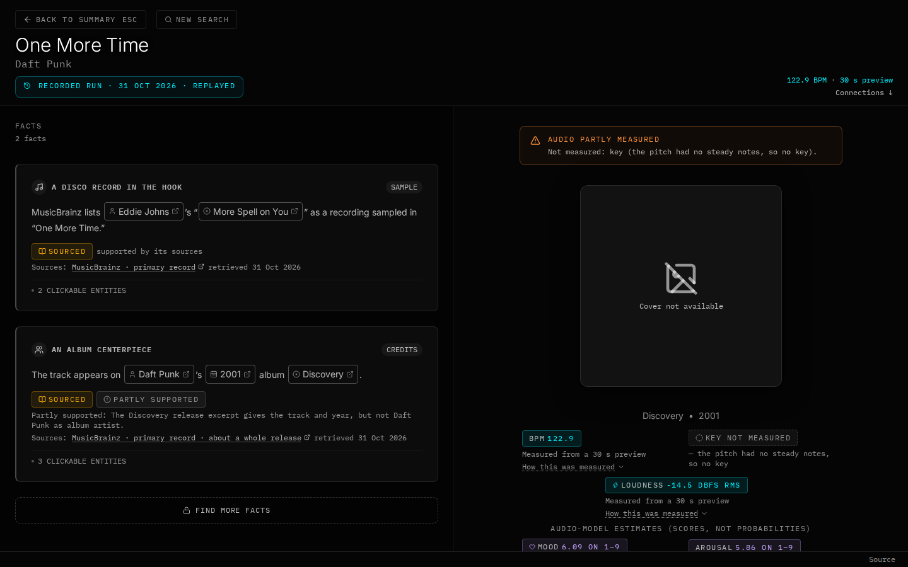
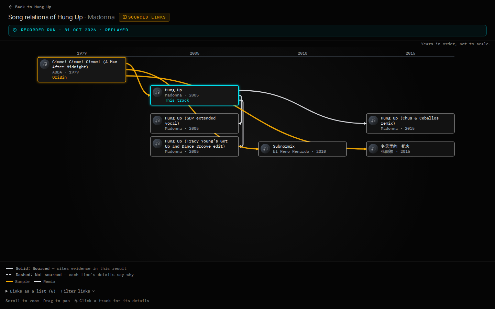
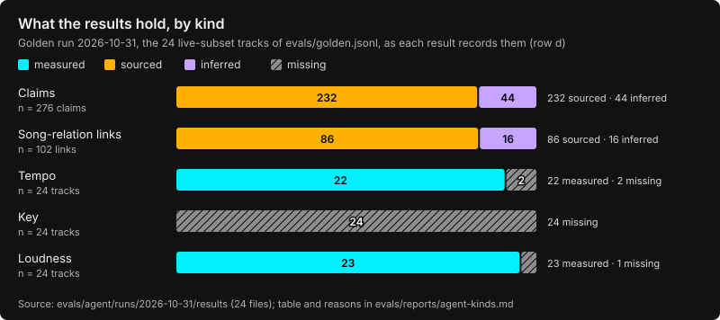

# Liner Notes

Given a song, Liner Notes traces its samples, credits, history and sound, and shows which claims
are **measured**, **sourced** or **inferred**.

You type a song. The app finds the recording, measures its tempo and loudness from a 30 s
preview (and its key when the pitch is clear enough, which is rare: see
[Known limitations](#known-limitations)), reads what primary records (MusicBrainz, Discogs,
SecondHandSongs, Genius and others) say about it, and has a model write liner notes from that
evidence. A verifier then checks the model's claims against the excerpts they cite (one judge
call per run, up to a fixed number of claims; any left over get no verdict and are not shown as
sourced). Every value on the page says how it is known, and a value nobody knows is shown as
missing, with the reason.

It is a working web app with an evaluation behind each figure below. Its deployment files are
deploy-ready (not operated): no public instance runs.

More in [`docs/`](docs/): the [design notes](docs/design.md), the
[failure cases](docs/failures.md), what is stored and for how long ([privacy](docs/privacy.md))
and the [release checklist](docs/release.md).



## What a page shows

| kind | meaning | example |
| --- | --- | --- |
| **measured** | computed by the audio service from the track's 30 s Deezer preview | tempo 122.9 BPM, loudness -14.5 dBFS RMS |
| **sourced** | stated by a record or an excerpt the page cites, support-checked against the cited excerpt | "One More Time" samples "More Spell on You" by Eddie Johns (MusicBrainz) |
| **inferred** | written or estimated by a model and not backed by what it cites; labelled as such | a possible relation the model proposed, the audio models' mood and style scores |
| **missing** | not known, with the reason | "Key not measured — the pitch had no steady notes, so no key" (the chip is set in capitals) |

The song-relations map draws **retrieved** edges, built by code from a record that states the
relation, and **proposed** edges, which the model suggested. A proposed edge is drawn as a sample
or cover only when its own claim was found supported; otherwise it is an inferred influence.
[`docs/design.md`](docs/design.md) explains the evidence model, the verifier and why measured
values never come from the model.

| Search | Player |
| --- | --- |
|  |  |



The screenshots are taken from the showcase replays by `node scripts/readme-shots.mjs` (it starts
the API with `REPLAY_MODE=only` and dummy keys, and the web app, on free local ports, with
outbound network denied; see the script's header). The map is Hung Up's, whose timeline fits the
1440 px window; One More Time's runs past its right edge. The browser loads nothing from outside
the page's origin, so the album cover shows as not available; `--covers` lets the Cover Art
Archive's image load.

## The showcase

Five tracks are served from recorded runs (`fixtures/replays`) whenever live analysis is off or
unavailable: One More Time (Daft Punk), Bitter Sweet Symphony (The Verve), Hung Up (Madonna),
Praise You (Fatboy Slim) and Natural Blues (Moby). A replayed page says "Recorded run", with the
date and commit it was recorded at.

They were not picked by hand. `node evals/agent/showcase.mjs` chooses them from the golden run's
records (below) by a rule, and `evals/agent/showcase.test.mjs` checks that the committed
recordings are its choice. A row is eligible when the run resolved the row's own recording,
measured a tempo from the signal, has the Cover Art Archive's front image of the release its
MusicBrainz record names, copied no measured field from model text and showed no model claim as
sourced without the judge's verdict, has at least 5 code-built sourced links on its map, has a
MusicBrainz genre, and shows no claim whose relation is named "Possible …". The eligible rows
that were showcases before are kept, then the eligible rows of a style not yet chosen are added,
most code-built links first (ties by ISRC order), until there are at least 5 tracks and 4 styles.

- 7 of the 24 golden-run rows are eligible. Gangnam Style (PSY) tied with Natural Blues and
  Praise You at 8 code-built links and lost the tie on ISRC order; with those two the rule had
  five tracks of five styles and stopped. Running Up That Hill (Kate Bush) shares its style, pop,
  with Hung Up. Juicy, a showcase before this rule, is not eligible: its run resolved a later
  reissue ([failure cases](docs/failures.md#identity-resolves-a-later-reissue-juicy)).
- The page rule alone leaves out **Gangsta's Paradise** (Coolio feat. L.V.) and **The Less I
  Know the Better** (Tame Impala): each page would show a relation as "Possible". For
  Gangsta's Paradise that relation is documented: the page would show "Possible sample" next to
  the sample its MusicBrainz record states. Leaving hedged relations out is a choice for the
  demonstration; other pages show them.

The showcase is a demonstration, not a sample of how the app does in general: the rule keeps the
runs that went well. The evaluation below covers every row.

## What the results hold, by kind

Over the golden run (24 tracks, the live subset of `evals/golden.jsonl`; 2026-10-31, commit
`5fd193fa7a64`, tag `golden-run-2026-10-31`), by kind, as each result records it:



- Claims: 232 of 276 sourced (84.1 %, 95 % CI [79.3, 87.9]): 164 built by code from a record, 68
  written by the model and support-checked against their excerpts; 44 inferred. 3 of the
  inferred claims were found contradicted, and the page shows them only in its rejected panel.
- Song-relation links: 86 of 102 sourced (84.3 % [76.0, 90.1]), 16 inferred. One inferred link,
  whose claim was contradicted, is not drawn, so the maps show 101.
- Tempo: measured on 22 of 24 tracks (91.7 % [74.2, 97.7]); one track had no Deezer preview and
  one tempo was withheld as unsteady.
- **Key: never served on the golden set**: measured on 0 of 24 (0.0 % [0.0, 13.8]). The audio
  service withheld it on all 23 previews it analysed (19 for no sustained pitch, 2 as
  speech-like, 1 with too few pitch classes, 1 with one harmonic series); the 24th track had no
  preview. Why, in [Known limitations](#known-limitations) ("Keys are rarely served").
- Loudness: measured on 23 of 24 (95.8 % [79.8, 99.3]); the 24th track had no preview.

Counts, intervals and reasons are in [`evals/reports/agent-kinds.md`](evals/reports/agent-kinds.md),
written with the chart by `node evals/agent/kinds.mjs` from the committed run records (no
network, no model); `evals/agent/kinds.test.mjs` pins the counts.

## Evaluation

Every figure gives its dataset, n and a 95 % interval (Wilson for proportions, a percentile
bootstrap over tracks for the agent's means, a BCa bootstrap for the MIREX key scores), with the
date and commit of the run. Rows with n < 10 are
counts only. The full reports, with how to read them, are in [`evals/reports/`](evals/reports/).

### The agent

Dataset: the 24-row live subset of `evals/golden.jsonl` (45 rows; gold labels cite their
sources, none come from listening). Run 2026-10-31 at commit `5fd193fa7a64`, which is not in
`main`'s history (the branch was squashed) and is kept by the tag `golden-run-2026-10-31`.
Pipeline on `gpt-6-luna`, judge on `gpt-6-sol`. Report:
[`evals/reports/agent-2026-10-31.md`](evals/reports/agent-2026-10-31.md); run records:
[`evals/agent/runs/2026-10-31`](evals/agent/runs/2026-10-31).

What a page shows (row d, after the verifier):

| metric | dataset | value | n | 95 % CI |
| --- | --- | --- | --- | --- |
| preview coverage | golden live subset | 95.8 % (23/24) | 24 | [79.8 %, 99.3 %] |
| identity accuracy (recording level) | golden live subset | 70.8 % (17/24) | 24 | [50.8 %, 85.1 %] |
| clarification rate | golden live subset | 58.3 % (14/24) | 24 | [38.8 %, 75.5 %] |
| code-built edge coverage | golden live subset, gold edges | 43.8 % (7/16) | 16 | [23.1 %, 66.8 %] |
| pre-verifier support rate (model claims, row c; 14 not judged, counted as not supported) | golden live subset | 51.8 % (58/112) | 112 | [42.6 %, 60.8 %] |
| claims shown as sourced | golden live subset | 84.1 % (232/276) | 276 | [79.3 %, 87.9 %] |
| schema-valid rate | golden live subset | 100.0 % (24/24) | 24 | [86.2 %, 100.0 %] |
| fallback rate | golden live subset | 0.0 % (0/24) | 24 | [0.0 %, 13.8 %] |
| latency p50 | golden live subset | 23.4 s | 24 | [21.4 s, 25.0 s] |
| USD per analysis (mean) | golden live subset | USD 0.0102 | 24 | [USD 0.0092, USD 0.0113] |

Ablations, scored against the 16 gold edges of the same dataset (precision over the edges each
row proposed):

| row | what it runs | edge recall | edge precision | hallucinated samples (5 no-sample tracks) |
| --- | --- | --- | --- | --- |
| a | model only, no tools or evidence (`gpt-6-sol`) | 68.8 % (11/16) [44.4, 85.8] | 91.7 % (11/12) [64.6, 98.5] | 0/5 |
| b | code only, no model: retrieved edges | 43.8 % (7/16) [23.1, 66.8] | 7/8 (n < 10) | 0/5 |
| c | pipeline before the verifier: retrieved and proposed edges | 87.5 % (14/16) [64.0, 96.5] | 70.0 % (14/20) [48.1, 85.5] | 0/5 |
| d | pipeline after the verifier (what the page shows as documented) | 50.0 % (8/16) [28.0, 72.0] | 80.0 % (8/10) [49.0, 94.3] | 0/5 |

Row a runs on a different model from rows c and d, so it changes the model as well as the tools.
Its edges are the model's recollection: none is shown as sourced (0/70 claims, by construction:
it has no evidence to cite). The verifier trades recall for precision: from c to d, recall falls
from 14 to 8 of 16 and precision rises from 70.0 % to 80.0 %. The intervals overlap widely
(recall on 16 gold edges, precision on 20 and 10 proposed edges), so neither change is
established. Only one gold edge is held out from every source the pipeline queries, so held-out
recall is not reported as a rate.

The verifier as a classifier, on [`evals/perturb.jsonl`](evals/perturb.jsonl) (81 claim cases:
27 claims supported by construction or by a deterministic check, and 54 mutations of them;
judge `gpt-6-sol`, recorded 2026-10-31 at `5fd193fa7a64`, tag `golden-run-2026-10-31`):

| metric | dataset | value | n | 95 % CI |
| --- | --- | --- | --- | --- |
| false-positive rate (supported claims rejected) | perturb set, positives | 0.0 % (0/27) | 27 | [0.0 %, 12.5 %] |
| catch rate (mutations rejected) | perturb set, mutations | 98.1 % (53/54) | 54 | [90.2 %, 99.7 %] |

The positives are never labelled by a verdict, and a mutation is unsupported by its excerpt,
which is not the same as false. There is one judge model (a judge from another family is not
available) and no agreement with human labels yet.

### The audio service

Tempo and key from the service as it serves them (its withholding rules included), with
Essentia, the default, and librosa, the fallback. A withheld value counts as not correct in
"correct / n". Acc1: within 4 % of the reference tempo; Acc2: also up to octave and meter
errors; MIREX: the weighted key score.

| dataset | n | estimator | answered | correct / n | correct / answered | run |
| --- | --- | --- | --- | --- | --- | --- |
| Ballroom, tempo | 200 | Essentia | 133/200 = 66.5 % [59.7, 72.7] | Acc1 106/200 = 53.0 % [46.1, 59.8]; Acc2 129/200 = 64.5 % [57.7, 70.8] | Acc1 106/133 = 79.7 % [72.1, 85.7] | 2026-10-29, `9682a4a` of #244 (merged as `4f194db`), analyzer 2.3.4 |
| Ballroom, tempo | 200 | librosa | 139/200 = 69.5 % [62.8, 75.5] | Acc1 109/200 = 54.5 % [47.6, 61.3]; Acc2 135/200 = 67.5 % [60.7, 73.6] | Acc1 109/139 = 78.4 % [70.9, 84.4] | 2026-10-29, `9682a4a` of #244 (merged as `4f194db`), analyzer 2.3.4 |
| GiantSteps+ Key | 250 | Essentia | 48/250 = 19.2 % [14.8, 24.5] | MIREX 38.8/250 = 15.5 % [11.6, 20.4]; exact 36/250 = 14.4 % [10.6, 19.3] | MIREX 38.8/48 = 80.8 % [69.6, 89.2] | 2026-10-29, `2901b7f` of #256 (merged as `2cf712e`), analyzer 2.3.4 |
| GiantSteps+ Key | 250 | librosa | 48/250 = 19.2 % [14.8, 24.5] | MIREX 35.8/250 = 14.3 % [10.6, 19.1]; exact 32/250 = 12.8 % [9.2, 17.5] | MIREX 35.8/48 = 74.6 % [62.9, 84.1] | 2026-10-29, `2901b7f` of #256 (merged as `2cf712e`), analyzer 2.3.4 |
| GiantSteps Tempo | 400 | Essentia | 156/400 = 39.0 % [34.3, 43.9] | Acc1 93/400 = 23.2 % [19.4, 27.6]; Acc2 129/400 = 32.2 % [27.9, 37.0] | Acc1 93/156 = 59.6 % [51.8, 67.0] | 2026-10-25, `78555ce` of #89 (merged as `28cdaaf`), analyzer 2.1.0 |
| GiantSteps Tempo | 400 | librosa | 216/400 = 54.0 % [49.1, 58.8] | Acc1 91/400 = 22.8 % [18.9, 27.1]; Acc2 128/400 = 32.0 % [27.6, 36.7] | Acc1 91/216 = 42.1 % [35.7, 48.8] | 2026-10-25, `78555ce` of #89 (merged as `28cdaaf`), analyzer 2.1.0 |

Reports: [`evals/reports/audio-2026-10-29.md`](evals/reports/audio-2026-10-29.md) (Ballroom,
GiantSteps+ Key) and [`evals/reports/audio-2026-10-25.md`](evals/reports/audio-2026-10-25.md)
(GiantSteps Tempo); the harness is in [`evals/audio`](evals/audio/README.md). Their limits:

- **One 30 s window per clip**, the length of the previews the app measures, scored against
  labels for the whole excerpt, with ambiguous key labels left out. The figures cannot be
  compared with published ones for these datasets.
- **beat-this**, measured as a candidate and not shipped, was trained on Ballroom: its Ballroom
  figure (Acc1 148/200 = 74.0 % [67.5, 79.6]) is on its own training data. On GiantSteps Tempo
  it had Acc1 109/400 = 27.3 % [23.1, 31.8]. Both are in the 2026-10-25 report
  (`docs/design.md`, "Alternatives that were rejected").
- **Analyzer versions**: the service is now at 2.3.6. A controls run at 2.3.6 gave the same
  outputs as at 2.3.4 (`evals/audio/README.md`; the run is
  `evals/reports/audio-2026-10-30.md`); GiantSteps Tempo was last measured at 2.1.0.
- The audio is commercial excerpts, fetched for evaluation only and never committed; the
  annotations' licences are in [NOTICE](NOTICE).

## Known limitations

Each is a known behaviour, not a planned fix. [`docs/failures.md`](docs/failures.md) shows the
ones marked "case" from a committed replay or run record.

**What a page shows**

- **A fact can be stated twice** (case). The reader that drops a model claim restating a record
  recognises a fixed set of phrasings; a claim worded "MusicBrainz lists X as a recording
  sampled in Y", or "draws on X", is kept beside the record's own claim. In the showcase this is
  One More Time's sample card, and its album; Gangsta's Paradise is left out of the showcase for
  this reason.
- **Tempo octave errors** (case). The analyzer can report double the felt tempo: Bitter Sweet
  Symphony is measured at 171.15 BPM, while the song is usually given as about 86 BPM. The value
  is shown as measured, because it is the analyzer's output.
- **A verifier reason can misstate its excerpt** (case). On Praise You a production claim is
  shown as partly supported, and the judge's reason says the excerpt does not name "Balance &
  Rehearsal", although it does.
- **Identity can miss the original recording** (case). In the evaluation, 7 of 24 rows did not
  resolve the row's own MusicBrainz recording (identity accuracy 17/24, [50.8 %, 85.1 %], in
  [the agent table](#the-agent)): 3 took a later reissue (Juicy, Ice Ice Baby, I'll Be Missing
  You), 2 had the right ISRC but reached another MusicBrainz recording (U Can't Touch This, Take
  On Me), and 2 reached no MusicBrainz recording at all (Levels, Crazy). None of the 7 pages has
  a sample link built from a record.
- **Keys are rarely served.** The service withholds a key unless the clip has clear, steady
  pitch. It answered a key for 48 of 250 GiantSteps+ clips (19.2 % [14.8, 24.5], MIREX 80.8 %
  [69.6, 89.2] on those; [the audio table](#the-audio-service)) and for none of the 23
  golden-run previews it analysed ([by kind](#what-the-results-hold-by-kind)).
- **The flat `audioSource` field reads "unavailable" whenever no key is measured**, even beside
  a measured tempo, in the API's payload. The page reads the audio block, which says what was
  measured.
- **No Deezer preview, no clip.** A track with no Deezer preview has no clip in the Player, and
  nothing is measured for it. Spotify's preview is never used in its place.
- **Map buttons that do nothing when pressed.** On the song-relations map, the link stops, the
  analysed track's card and the timeline markers are buttons that do nothing when pressed:
  focusing one shows its details.
- **The full-size map credits no provider.** The full-size map view (`/t/<id>/map`) plays
  related tracks' clips, Spotify's among them, without a list of data providers; the Player
  credits them.

**Sources and audio**

- **SecondHandSongs needs its key** (case). Without `SHS_API_KEY` every request is refused
  (HTTP 403), and the evaluation report counts it apart from source errors.
- **A cut copy declared complete is measured.** The audio service refuses a preview whose
  transfer cannot be checked, or that ends short of its `Content-Length` or its last chunk. A
  transfer that is complete but whose content is a cut copy of the file is still measured short,
  for example when a CDN edge re-chunks a cut origin response: framing proves only the last hop
  (#290, `services/audio/README.md`).
- **A failed download reads as a failed analysis.** When the preview cannot be downloaded
  (timeout, cut transfer, size cap, unchecked length), the page shows "The audio analysis
  failed." Nothing is stored, and the next run tries again (#291).
- **A failed download's detail can hold the clip link.** For some 502 answers from the preview
  host, the API keeps the response's percent-encoded clip link in the analysis's
  `unavailableDetail`, a field of the run's state that its checkpoint keeps. The link is a
  short-lived signed CDN URL (about 15 minutes) and is never recorded in a cassette.
- **Old runs measured on Spotify's clip.** A direct run link (`/api/runs/:id`) still serves a
  run that was measured on Spotify's clip before Spotify's audio stopped being analysed, as
  recorded and labelled `preview.provider: "spotify"`, until retention removes it (30 days by
  default). `/api/runs/by-track/:id` no longer serves it as the track's run.

**Recordings and checks**

- **A link without a scheme in a source's error body is kept.** The shared scrub for recorded
  source answers masks links that start with a scheme. A link written without one (for example
  `cdnt-preview.dzcdn.net/...`) inside a source's error body is kept in that source's cassette.
  The audio step's entry masks it, and committed cassettes are checked for preview hosts before
  they land.
- **The contract check reads one step.** `npm run contract:check` compares the "Contract
  compatibility" step, its job's settings and the workflow's own settings, and refuses a
  `ci.yml` written outside the YAML subset it reads. It does not notice an earlier step in the
  same job that changes what the check reads (an `npm` shim on `PATH`, a write to
  `packages/contract/BREAKING-CHANGES`, older sources checked out first), or a change to the root
  `package.json` `contract:check` script (#288).

**Licence and distribution**

- **The source offer holds only once the repository is public.** `NOTICE` offers the source to
  network users through the footer's "Source" link; until the repository is public, the site
  stays private (`deploy/RUNBOOK.md`).
- **The published images do not carry `LICENSE` or `NOTICE`.** The audio image's build context
  is `services/audio`, and the web and API images allowlist their files.
- **Bundled library licences are as stated upstream.** TensorFlow and the libraries linked into
  Essentia carry no licence text in the wheel; their licences in `NOTICE` are as their projects
  state them, some versions are not stated in the binary, and the lists may not be complete.

## Architecture

```mermaid
flowchart LR
  browser["Browser<br/>React app"] -->|"/api, server-sent events"| caddy["Caddy<br/>(web image)"]
  caddy --> api["API<br/>Express 5"]
  api --> graph
  subgraph graph["LangGraph run"]
    direction LR
    scout --> clarification{"track picker<br/>(when unsure)"}
    scout --> engineer
    scout --> historian
    clarification --> engineer
    clarification --> historian
    engineer --> composer
    historian --> composer
    composer --> verifier
  end
  scout -.-> spotify["Spotify<br/>search, metadata"]
  engineer -.-> deezer["Deezer<br/>preview clip"]
  engineer -.-> audio["Audio service<br/>FastAPI, Essentia"]
  historian -.-> records["MusicBrainz, Discogs, SecondHandSongs,<br/>Genius, ListenBrainz, Last.fm, Tavily"]
  composer -.-> llm["Azure OpenAI<br/>composer, judge"]
  verifier -.-> llm
  api --- db[("SQLite<br/>runs, caches,<br/>checkpoints")]
  api --- replays[("fixtures/replays<br/>recorded runs")]
```

- **scout** finds the track on Spotify; when the match is not clear it stops at the **track
  picker** and waits for the visitor's choice.
- **engineer** finds the Deezer preview of the recording (by its ISRC, else a strict search
  match) and sends it to the audio service, which returns the measured block (or why it measured nothing).
- **historian** resolves the recording on MusicBrainz and gathers primary records and search
  excerpts into the run's evidence pack; code builds the sourced claims and links from it.
- **composer** writes the notes from the evidence; it has no field for a measured value.
- **verifier** checks every claim (deterministic checks, the numeric check, one judge call),
  sets each claim's kind, writes the measurement in and completes the run
  ([`docs/design.md`](docs/design.md#the-verifier)).
- Results are stored in SQLite and served again by run or by track; recorded runs are replayed
  with `REPLAY_MODE`. In deployment, Caddy serves the built web app and forwards `/api` to the
  API, and only the API reaches the audio service.

## Tech stack and sources

| layer | stack |
| --- | --- |
| Web app | React 19, TypeScript, Vite, Tailwind CSS v4; the map drawn with `d3-selection`, `d3-zoom`, `d3-drag` and `d3-transition`; Recharts for the fingerprint chart; Lucide icons; self-hosted Inter and IBM Plex Mono |
| API | Node.js 24, Express 5, LangGraph 1.5, zod (the shared contract in `packages/contract`), SQLite through `better-sqlite3` |
| Models | Azure OpenAI through the API's provider layer (`apps/api/src/llm`), with a shared spend log and budget caps; the composer and the judge on different deployments by default |
| Audio service | Python 3.12, FastAPI; Essentia (`RhythmExtractor2013` and `KeyExtractor`) by default, librosa as the fallback; Essentia's TensorFlow models for the style and mood scores |
| Deployment | Docker Compose, Caddy, Cloudflare Turnstile (`deploy/`) |
| Tooling | npm workspaces, uv, Biome, ruff, Vitest, pytest, Playwright |

Sources, each read by the API (`apps/api/src/sources`), under the terms listed in
[NOTICE](NOTICE):

| source | what it gives |
| --- | --- |
| MusicBrainz | the recording, its releases, works and relations (samples, covers, remixes) |
| Cover Art Archive | the front cover of the release MusicBrainz names |
| Deezer | the 30 s preview the audio service measures, found by ISRC |
| Spotify | search, track metadata, cover images, and the preview clips of related tracks that the map plays, credited in the Player. Spotify's audio is no longer analysed (see "Old runs measured on Spotify's clip") |
| Last.fm | genre tags and similar tracks |
| Genius | song relationships (samples, covers, remixes); never lyrics |
| ListenBrainz | similar artists, from listening sessions |
| SecondHandSongs | originals and covers of the song (needs `SHS_API_KEY`, see above) |
| Discogs | release credits (needs `DISCOGS_TOKEN`) |
| Tavily | web search excerpts, cited as evidence |

## Run it locally

Three services run side by side: the web app, the API and the audio service.

### Prerequisites

- Node.js 24 or later, with npm 11.18 or later (it enforces the install-script allowlist in `.npmrc`)
- Python 3.12+
- [uv](https://docs.astral.sh/uv/) (Python package manager)

### 1. Install Dependencies

```bash
# Web app, API and shared packages (npm workspaces, one lockfile)
npm ci

# Python audio service
cd services/audio && uv sync
```

### 2. Environment Variables

```bash
cp apps/api/.env.example apps/api/.env
chmod 600 apps/api/.env
```

Edit `apps/api/.env` with your keys. The API refuses to start without the Spotify pair. Every
variable `apps/api/.env.example` lists, where it explains each one in full:

| variable | what it sets |
| --- | --- |
| `SPOTIFY_CLIENT_ID`, `SPOTIFY_CLIENT_SECRET` | required; from the [Spotify Developer Dashboard](https://developer.spotify.com/dashboard). With `REPLAY_MODE=only` Spotify is never called and any value starts the API |
| `LLM_PROVIDER` | the model provider: `azure` (default); `gemini` is not implemented and refuses every call |
| `AZURE_OPENAI_API_KEY`, `AZURE_OPENAI_ENDPOINT` | the Azure OpenAI resource's key and root URL (`https://<resource>.cognitiveservices.azure.com/`); calls use its v1 API |
| `AZURE_OPENAI_BASE_URL`, `AZURE_OPENAI_API_VERSION` | a v1 base URL used instead of the endpoint's; the API version is accepted and not used |
| `AZURE_OPENAI_DEPLOYMENT_FAST`, `_MAIN`, `_RESEARCH`, `_JUDGE`, `_PRO` | the deployment of each tier (fast: scout, classification, research planner; main: composer; research: summaries; judge: verifier). `_PRO` is the fallback for research and judge, and `_FAST` for main. Defaults `gpt-6-luna` for fast and main, `gpt-6-sol` for research and judge |
| `LLM_SPEND_LOG` | absolute path of the spend log (JSONL) shared by every process; live model calls are refused while it is unset or missing. Create it once with `npm run smoke:llm -w apps/api -- --init` |
| `BUDGET_TOTAL_USD`, `BUDGET_DAILY_USD`, `BUDGET_EVAL_FLOOR_USD`, `BUDGET_EVAL_GOLDEN_USD`, `BUDGET_EVAL_BASELINE_USD`, `BUDGET_EVAL_PERTURB_USD`, `BUDGET_EVAL_VARIANCE_USD` | budget caps in USD over the spend log: total, per UTC day, the evaluation floor and each evaluation's own cap |
| `LLM_TIMEOUT_MS`, `MAX_LLM_CALLS_PER_RUN`, `LLM_CONCURRENCY` | one attempt's timeout, model calls per analysis, calls in flight per process |
| `LLM_CASSETTE`, `LLM_CASSETTE_DIR` | record or replay model answers (tests and evals only; refused in production) |
| `SOURCE_CASSETTE`, `SOURCE_CASSETTE_DIR` | the same for the music and search sources and the audio service |
| `LLM_RUN_PURPOSE` | the evaluation an API process runs for (`eval:golden`, `eval:baseline`, `eval:perturb`, `eval:variance`), and the cap it spends from |
| `LLM_ALLOW_TRACING` | `1` allows live calls while LangChain/LangSmith tracing is on; they are refused otherwise |
| `TAVILY_API_KEY` | [Tavily](https://tavily.com/) web search |
| `SOURCE_USER_AGENT` | optional: the `User-Agent` sent to the sources, as `AppName/Version ( contact )`; defaults to this project |
| `LASTFM_API_KEY` | [Last.fm](https://www.last.fm/api/account/create) genre tags and similar tracks |
| `DISCOGS_TOKEN` | optional: a Discogs personal access token, for release credits |
| `SHS_API_KEY` | optional in the code, but without it SecondHandSongs refused every request in the evaluation (HTTP 403) |
| `GENIUS_ACCESS_TOKEN` | optional: a Genius client access token, for song relationships (never lyrics) |
| `AUDIO_ANALYSIS_URL` | the audio service, `http://localhost:3002` in development |
| `PORT`, `HOST` | the API's port (3001) and address (127.0.0.1) |
| `LOG_LEVEL`, `LOG_FILE`, `LOG_IP_SALT` | log level, an optional file for the JSON lines, and the key of the hashed client addresses ([privacy](docs/privacy.md)) |
| `REPLAY_MODE`, `REPLAY_DIR` | `off` (default), `fallback` or `only`, and the directory of the recorded runs (`fixtures/replays`) |
| `CORS_ORIGINS` | the browser origins allowed to call the API; unset in development, the local web ports |
| `RUN_TOKEN_SECRET`, `TURNSTILE_SECRET_KEY`, `TURNSTILE_EXPECTED_HOSTNAME`, `TURNSTILE_BYPASS` | run tokens and the Cloudflare Turnstile check behind them; both secrets are required in production (see "Deploying") |
| `SSE_HOLD_MS` | development and tests only: hold a replayed stream open before its first event |
| `TRUST_PROXY` | how many reverse proxies in front of the API are trusted for the client address |
| `RATE_LIMIT_WINDOW_MS`, `RATE_LIMIT_MAX`, `RATE_LIMIT_GLOBAL_MAX`, `SEARCH_RATE_LIMIT_WINDOW_MS`, `SEARCH_RATE_LIMIT_MAX` | per-address and global rate limits |
| `SQLITE_DB_PATH` | the database (default `data/sonic-agent.db` in `apps/api`) |
| `CHECKPOINT_RETENTION_HOURS`, `STORE_RETENTION_DAYS`, `RUN_RETENTION_DAYS`, `RUN_EVENT_RETENTION_DAYS` | how long checkpoints, stored items, runs and run events are kept ([privacy](docs/privacy.md)) |

`npm run smoke:llm -w apps/api` makes one small call per tier through the provider layer and
prints status, latency, tokens and estimated cost; it spends from the budget like any other call.
To run with no real key, set `REPLAY_MODE=only` (any Spotify values): the showcase tracks are
served from their recordings, and any other query is refused.

The model tiers, budget caps, cassettes and limits are documented in `apps/api/.env.example`.

### 3. Run All Services

```bash
npm run dev
```

This starts the web app (port 3000), the API (port 3001) and the audio service (port 3002).
Override the ports with `WEB_PORT`, `API_PORT` and `AUDIO_PORT`, or pick services with
`DEV_SERVICES=web,api`. Each service can also run alone: `npm run dev -w apps/web`,
`npm run dev -w apps/api`, `npm run dev -w services/audio`.

The web app calls the API at `/api` on its own origin, and the Vite dev server forwards those
requests to the API on `API_PORT` (default 3001), or to `API_PROXY_TARGET` when set (an http(s)
origin such as `http://192.168.1.20:3001`, for an API running elsewhere). A build can point the web app elsewhere with
`VITE_API_URL`, the API's root URL including `/api` (see `apps/web/.env.example`); the web
image is built with `VITE_API_URL=/api` and its Caddy forwards `/api/*` to the API. A value that
cannot work (`api`, or an absolute URL without a path) stops the build with an error.
`VITE_SOURCE_URL` sets where the footer's "Source" link points (default
`https://github.com/josefdc/liner-notes`): a build of a modified version should point it at its
own source.

The web dev server listens on loopback only. `WEB_HOST=0.0.0.0 npm run dev` serves it on the
network (to try it from a phone, say); anyone who can reach that port can then also start
analyses through the `/api` proxy, on your model budget.

The audio service needs [uv](https://docs.astral.sh/uv/); without it, run
`DEV_SERVICES=web,api npm run dev`.

Then open http://localhost:3000

### 4. Checks

```bash
npm run lint           # Biome (lint + formatting); `npm run format` rewrites files
npm run typecheck      # TypeScript in every workspace
npm run guard:honest   # ratcheted counts (see below); lower the baselines with -- --update
npm run check:release-age -- --base origin/main   # changed lock entries are releases at least 14 days old
npm test               # Vitest: API, web and script tests
node --test 'evals/**/*.test.mjs'   # the evaluation scripts' tests (no network, no model)
npm run check:links    # relative links and #anchors in the tracked Markdown files (offline)
node evals/agent/kinds.mjs --check  # the README's chart and evals/reports/agent-kinds.md match the run records
npm run build && npm run check:css   # the built CSS is Tailwind output with no invalid values
npm run test:e2e       # Playwright against a development build of the web app served by vite preview with a mocked API (Google Chrome; PLAYWRIGHT_WEB_PORT, default 3290)
npm run test:visual    # the visual baselines, in the pinned Playwright container (Docker)
cd services/audio && uv run ruff check . && uv run ruff format --check .
cd services/audio && uv run pytest -q
```

The visual baselines (`tests/web/visual.spec.ts`) compare the search, the track picker, the
Dashboard, the Player and the song-relations map, at rest and with a track selected, drawn from the
mock fixtures at 768, 1024, 1280, 1380, 1440 and 1680 px and at device pixel ratio 1 and 2, and the
parts of the Dashboard and the Player below the fold at 768, 1024 and 1440 px, with the PNGs in
`tests/web/__screenshots__/`. `npm run test:visual` runs them in the Playwright image pinned by
digest (its linux/amd64 manifest) in `scripts/visual.mjs`, the one CI's visual job runs in, with
the checkout mounted. It needs Linux on x64 and Docker, and `npm ci` run first: the mounted
`node_modules` must hold the linux-x64 builds of esbuild, rollup and lightningcss, and an arm64
image draws differently. After a change that is meant to change a view, run
`npm run test:visual:update`, look at the PNGs it rewrote and commit them. Off Linux x64, push
the change and take the `*-actual.png` files from the `visual-report` artifact of CI's failed
visual job (drawn by the same image), look at them, and copy each over its baseline in
`tests/web/__screenshots__/visual.spec.ts/` without the `-actual` in its name. Baselines come
only from that image: the `visual` project exists only in its container (`PLAYWRIGHT_VISUAL=1`
stops any other run), and a baseline drawn by another browser, or outside the container, would
not match CI's.

The honesty guard (`scripts/guard-honest.mjs`) counts patterns that may only go down: placeholder
data (random values, stock images, unscoped colours), the prototype's old copy and product name, and
emoji in progress and log messages, in the source and in the messages of the recorded runs
(`fixtures/replays`). Each count fails CI if it rises above its baseline in `scripts/guard-baseline.json`.

Dependencies take only releases that are at least 14 days old, a rolling window by publish time:
`min-release-age=14` in `.npmrc` for npm and `exclude-newer = "14 days"` for uv in the audio
service. npm applies the setting only when it resolves a version (npm ci installs what the lock
names wherever it still agrees with `package.json`), so add or update packages with `npm install`
and do not edit `package-lock.json` by hand.

`npm run check:release-age -- --base <ref>` (`scripts/check-release-age.mjs`) guards against that
mistake: a lock edited by hand, or resolved without the setting, that brings in a release too new.
It is not a security boundary against a change written to defeat it, which could as well edit the
CI workflow.

It compares the lock npm ci would use (`npm-shrinkwrap.json` if there is one, else
`package-lock.json`) with the one npm would have used at `<ref>`. While both files exist,
`package-lock.json` is also compared with `package-lock.json` at `<ref>`, so it cannot change
unchecked and take over when the shrinkwrap is removed. An entry counts as changed when it is new
or its version, resolved URL, integrity, name, link, bundle or `hasShrinkwrap` flag changed. A
changed entry fails if its `name` field is not a package name npm accepts (its rule for old
packages, which allows a leading `_` in a scope and `!'()*`), or if it has `hasShrinkwrap`
(npm then installs what the package's own shrinkwrap names). Otherwise it must be one of:

- an `https://registry.npmjs.org/<name>/-/<basename>-<version>.tgz` tarball (`<basename>` is the
  name without its scope) whose name and semver version match the entry (its `version`, and its
  `name` field or else its path), with an integrity in the lock; bundled (`inBundle`) entries
  with a resolved URL are checked the same way;
- an entry with no resolved URL but a semver version and an integrity, which npm resolves again
  as that version;
- a bundled (`inBundle`) entry with no resolved URL and no integrity, when the nearest entry above
  it that is not bundled is new or changed here, and so checked: its bytes come from that tarball;
- a workspace package, or a link to one of the `workspaces` at `<ref>` (in its lock's root entry or
  its `package.json`) or in the working tree's `package.json`, which npm ci reads (no check
  needed). A workspace that only the working tree's `package.json` declares must be a local folder
  whose entry has no resolved URL and no integrity, and its link must have no integrity; otherwise
  it fails. The `workspaces` in the lock's own root entry are never used for this.

A release passes when npmjs lists a publish time for its version at least the minimum age before
the check, and the lock's integrity agrees with the one npmjs lists for that version
(`dist.integrity`, and `dist.shasum` as `sha1-`): every token must be a hash, of an algorithm npmjs
lists for that version, and every hash must match. Anything else fails (exit 1): git, codeload,
`file:`, `http:` or other-host tarballs, links to other folders, an entry that disagrees with its
tarball, a missing integrity or one that differs from npmjs's, a bundled entry with no resolved URL
and no integrity under a package whose tarball is not checked here (unchanged, a workspace, or
not a registry release; if that package does not bundle it after all, npm resolves it with nothing
to verify it against), a version that is not semver or has no publish time, or a release that is
too new (named with its version, publish time and age). The hint to resolve the lock again with npm and its `min-release-age` is printed only for failures
that doing so can fix (a release too new, or an entry that disagrees with npmjs or lacks an
integrity); any other failure gets a note that the change must be undone or approved.

Two more things fail, even with an unchanged lock:

- a change to npm's registry settings in `.npmrc` (`registry`, `<scope>:registry`,
  `replace-registry-host`), which decide where npm ci fetches the tarballs from. A maintainer
  changes them on the base branch, past this check;
- a dependency spec in the root or a workspace `package.json` (`dependencies`, `devDependencies`,
  `optionalDependencies`, `peerDependencies`, `overrides`) that is not a registry range, a tag, an
  `npm:` alias of one, a `$name` override reference to a dependency the root `package.json`
  declares, or a `file:` path to a workspace folder (a `workspace:` spec is let through: npm does
  not support it and stops). npm ci resolves a spec the lock no longer satisfies again, outside the
  lock, so a git or URL dependency would escape the age rule.

What it does not cover:

- other `.npmrc` settings that change where the bytes come from or how they are fetched:
  proxies, `userconfig` and `globalconfig`, CA and TLS settings;
- `workspaces` patterns other than plain names, `*` and `**` (braces, `[]`, `?` and negation);
- `min-release-age-exclude[]` and `before`: a release npm would let through because of them still
  fails here;
- a dependency published with a shrinkwrap (`hasShrinkwrap`): it fails, and a maintainer must
  approve it;
- in CI, when the commit before a push to `main` cannot be fetched (after a force-push, or in a
  private repository without credentials), the job compares with the parent commit, with a
  notice, so it checks only the last commit of that push.

The minimum age is the largest of 14 days and `min-release-age` in `.npmrc` at `<ref>` and in the
working tree (a `min-release-age[]` list counts by its largest value, which can only be stricter
than npm), so a change cannot lower it for itself. Publish times and integrities come from
registry.npmjs.org whatever npm's settings say (`--registry <url>` overrides it). The check exits 2
when it cannot run: an unknown base, an unreadable lock, `package.json` or `.npmrc`, or a registry
it cannot read within three attempts per package and three minutes in all. An unchanged lock with
unchanged registry settings makes no registry request. CI runs it in its own job, against the
parent commit on a pull request and against the commit before the push on `main`.

#### Dependency advisories

`npm audit --omit=dev` advisories that stay in the lock, each with what was measured and how the API
handles it.

- **body-parser 2.3.0, [GHSA-27r3-jxmh-p828](https://github.com/advisories/GHSA-27r3-jxmh-p828)
  (high): reproduces against the API; mitigated in the API; 2.4.0 is taken once it is 14 days old
  (2026-11-05).** After it reads a compressed body, body-parser 2.3.0 leaves the decoder piped from
  the request with no error listener (`lib/read.js:113`, the success path of the `getBody`
  callback), so an error the decoder raises on bytes that arrive later ends the process. The API
  reaches that path for gzip and deflate bodies (`apps/api/src/http/middleware/encoding.ts:4,18`,
  ahead of `express.json` at `apps/api/src/http/app.ts:72-73`). It now gives that decoder an error
  listener (`ignoreLateDecoderErrors`, `encoding.ts:19,46`), so a late decoder error cannot end the
  process; a body that fails to decode is still answered with 400. The test "keeps serving when
  bytes reach the decoder after the body was read" (`apps/api/src/http/app.test.ts:400`) sends gzip
  and deflate bodies that end the decoder early, with a garbage tail and with a valid-member tail,
  in one write and after the answer; it passes with the listener and fails on 2.3.0 without it. The
  listener was also measured against the app on Node 24.16 and on the API image's 24.21. The 2.3.0
  charset check that follows the pipe runs only with a `verify` option, which `express.json` here
  does not set. The listener goes when 2.4.0 is taken.

CI runs the same checks on every pull request (`.github/workflows/ci.yml`).

## Deploying

`deploy/compose.prod.yml` runs the three images: `web` (Caddy, which serves the built app and
forwards `/api/*` to the API, `apps/web/Caddyfile`), `api` and `audio`. Only Caddy publishes a
port; browsers reach the API through it, and only the API calls the audio service. This is the
one Docker setup: for development, use `npm run dev` (above). The host must be x86_64
(`linux/amd64`): the audio service's Essentia wheels exist for no other Linux platform.

```bash
cp deploy/.env.example deploy/.env && chmod 600 deploy/.env   # then fill it in
docker compose -f deploy/compose.prod.yml up -d --build
docker compose -f deploy/compose.prod.yml ps                  # every service turns healthy
```

`deploy/.env.example` lists every setting the containers receive. Compose stops, naming the
variable, while `RUN_TOKEN_SECRET`, `TURNSTILE_SECRET_KEY`, `AUDIO_SERVICE_TOKEN`, `CORS_ORIGINS`
or `VITE_TURNSTILE_SITE_KEY` is empty. `CORS_ORIGINS` is the site's own origin
(`https://liner-notes.example`; locally `http://127.0.0.1:3180,http://localhost:3180`): a
browser that does not mark its requests as same-origin (no `Sec-Fetch-Site`, such as Safari
before 16.4) is refused on the analysis and on `POST /api/runs` unless its origin is listed. By
default the site is plain HTTP on http://127.0.0.1:3180. On a server, set `SITE_ADDRESS` to the
site's hostname (Caddy then serves HTTPS on 443 and redirects port 80 to it) and publish the
standard ports with `PROXY_BIND=0.0.0.0`, `PROXY_PORT=80` and `PROXY_TLS_PORT=443`. The images
are named `liner-notes-web`, `-api` and `-audio`, tagged `IMAGE_TAG` (default `latest`): a tag
per release lets a deploy go back to the previous images.

**Certificates.** With a hostname in `SITE_ADDRESS`, Caddy asks Let's Encrypt (or ZeroSSL) for
a certificate and stores it on the `caddy-data` volume. Behind Cloudflare's proxy, pick one of:

- **ACME over HTTP (the default).** It works when Cloudflare forwards plain-HTTP requests for
  `/.well-known/acme-challenge/` to port 80 of the server: "Always Use HTTPS" must not redirect
  them (turn it off, or exempt that path), also for the renewals every 60 days. The TLS-ALPN
  challenge does not pass the proxy; Caddy tries the HTTP challenge as well.
- **A Cloudflare Origin CA certificate** (SSL/TLS mode "Full (strict)"). With `SITE_ADDRESS`
  set to the hostname, copy `deploy/site.d/origin-ca.caddy.example` to
  `deploy/site.d/origin-ca.caddy` and put the certificate and key next to it, as that file says;
  compose mounts `deploy/site.d` read-only and Caddy reads its `*.caddy` files into the site. The
  web container runs as uid 10001 and must read them: the directory stays 755, `origin-ca.caddy`
  and `origin.pem` 644, and only the key goes to that user (`chmod 600 origin.key && sudo chown
  10001 origin.key`); on an SELinux host the mount also needs `:Z`. The container stops at start,
  naming the file, when it cannot read one. Then confirm that Caddy serves this certificate and
  asks no certificate authority:
  `docker compose -f deploy/compose.prod.yml logs web | grep 'skipping automatic certificate management'`.
  The certificate is trusted by Cloudflare only, so the site is reachable through the proxy only.
- **A DNS challenge.** It needs a web image built with Caddy's Cloudflare DNS module, which the
  shipped image does not have, and an API token for the zone: not set up here.

The runbook, `deploy/RUNBOOK.md`, has the Cloudflare side. Caddy serves HTTP/1.1 and HTTP/2
only: behind Cloudflare a visitor's HTTP/3 ends at Cloudflare's edge, which reaches the server
over TCP. Strict-Transport-Security is not sent here; it is set at Cloudflare (runbook).

| Service | Reached at | Notes |
|---------|------------|-------|
| `web`   | `PROXY_BIND:PROXY_PORT` (default 127.0.0.1:3180) and `PROXY_TLS_PORT` | Caddy; security headers and a Content-Security-Policy on every response but Caddy's own redirect from HTTP to HTTPS (a 308 with no body) |
| `api`   | `/api/*` through Caddy only | `NODE_ENV=production`, `TRUST_PROXY=1`, `REPLAY_MODE=fallback` by default; database on the `sonic-data` volume (`/app/data/sonic-agent.db`), spend log on `llm-spend` |
| `audio` | the API only | `linux/amd64`; models on the `audio-models` volume, fetched at the first start (up to 90 s) |

The database file keeps its name, `sonic-agent.db`, on the volume `liner-notes_sonic-data` (compose
prefixes the volume `sonic-data` with the project name, `liner-notes`). The earlier root
`docker-compose.yml` named its volume after the checkout's directory (`<directory>_sonic-data`),
so a database from it carries over by itself only from a checkout named `liner-notes`; otherwise
copy it once, with both stacks stopped:

```bash
docker run --rm -v <directory>_sonic-data:/from:ro -v liner-notes_sonic-data:/to \
  node:24-slim cp -a /from/. /to/
```

**Upgrading from the root `docker-compose.yml`.** Its containers (`sonic-web`, `sonic-server`,
`sonic-analysis`) keep their fixed names and port 80: remove them before the first start. When
the old stack ran as the project `liner-notes` (from a checkout of that name),
`docker compose -f deploy/compose.prod.yml up -d --remove-orphans` does it; otherwise
`docker rm -f sonic-web sonic-server sonic-analysis`. Never take a deployment down with
`down -v`: it deletes the volumes, the database and the spend log with them.

Live model calls need the spend log, which is never created by itself; create it once:

```bash
docker compose -f deploy/compose.prod.yml exec api node -e "require('fs').closeSync(require('fs').openSync('/app/spend/llm-spend.jsonl', 'wx'))"
```

**Turnstile.** The web image takes the widget's site key as a build setting
(`VITE_TURNSTILE_SITE_KEY` in `deploy/.env`, public); the API takes its secret key
(`TURNSTILE_SECRET_KEY`) and the site's hostname (`TURNSTILE_EXPECTED_HOSTNAME`). Cloudflare's
test keys (site key `1x00000000000000000000AA`, secret `1x0000000000000000000000000000000AA`)
always pass, which is how to try the production stack with a real check; leave
`TURNSTILE_EXPECTED_HOSTNAME` empty with them (Cloudflare reports their checks for
`example.com`).

**Without Cloudflare.** `deploy/compose.dev.yml` runs the production API and audio images as a
project of its own, `liner-notes-dev`, with its own containers, volumes and database, on
http://127.0.0.1:3182 (`DEV_PROXY_PORT`): starting it never touches the `liner-notes` project
(do not rename it to that with `-p`). It uses the API and audio images as they are, never
building, pulling or retagging them, so build them with the production file first; `--build`
builds only its web image (`liner-notes-web-dev`), which has no site key,
so the page sends the development bypass, which its API, in development, accepts; only recorded
runs are served by default (`DEV_REPLAY_MODE`). `deploy/check-stack.sh` checks a running stack
through Caddy, as CI does (`.github/workflows/docker.yml`). Its checks need `LOG_IP_SALT`, set
here for the run, and the local origin in `CORS_ORIGINS` (`http://127.0.0.1:3180`):

```bash
LOG_IP_SALT=check-stack docker compose -f deploy/compose.prod.yml up -d --build   # builds all three
deploy/check-stack.sh
LOG_IP_SALT=check-stack SSE_HOLD_MS=130000 \
  docker compose -f deploy/compose.prod.yml -f deploy/compose.dev.yml up -d --build
deploy/check-stack.sh long-stream   # a cut stream, then a stream held 130 s, through Caddy
docker compose -f deploy/compose.prod.yml -f deploy/compose.dev.yml down -v   # the dev project only
```

**Client addresses.** Caddy takes the visitor's address from `CF-Connecting-IP` only when the
request comes from one of Cloudflare's ranges, listed in `apps/web/Caddyfile` (`trusted_proxies`);
from any other peer the header is ignored. It sends the API that one address in
`X-Forwarded-For`, which the API trusts from one proxy (`TRUST_PROXY=1`) for its rate limits and
its hashed log addresses. Caddy's logs leave out the typed text and the run token: the access
log writes the query's `runToken` nowhere and `query`, `q`, `trackId`, `selectedTrackId`,
`trackTitle` and `trackArtist` as `REDACTED`, and Caddy's other lines (such as a stream the
visitor left) keep only the path. Ids stay, in Caddy's log and the API's: `threadId` and `runId`
in queries, and any in a path (`/t/<id>`, `/api/runs/<id>`, `/api/runs/by-track/<id>`).
No request headers or redirect targets are written, and addresses are shortened to their network.

**Content-Security-Policy.** The policy allows scripts from the site and Turnstile only. Cloudflare
features that add scripts to the page (Rocket Loader, the Web Analytics beacon, Bot Fight Mode's
JavaScript detections) are blocked by it: keep them off for the site, or extend the policy in
`apps/web/Caddyfile` (`deploy/RUNBOOK.md`).

**Cloudflare's addresses.** Cloudflare publishes its ranges at https://www.cloudflare.com/ips-v4
and https://www.cloudflare.com/ips-v6. Before each deploy, compare them with the list in
`apps/web/Caddyfile`; when they differ, update the list and its date, rebuild the web image, and
update the origin's firewall to match (`deploy/RUNBOOK.md`).

**Order.** Deploy the API before the web: a web build reads the event types of its own API
version, not an older API's. Roll both back together. The server, DNS, Cloudflare and Turnstile
settings, and backups are in the runbook, `deploy/RUNBOOK.md`.

`GET /api/health` is the liveness probe the containers' health checks use. `GET /api/ready`
answers 200 when the API can serve what it is set up to serve and 503 otherwise, listing each
check (database and migrations, audio service and its models, model provider, budget state).
While live analysis is not served (`REPLAY_MODE=only`, or `fallback` with live analysis off or
the budget spent) the audio service and the provider are not needed; with `REPLAY_MODE=off` a
spent budget answers 503. The answer is public and limited per address like search; it shows
check names and states (and the schema version), never a key, host, amount, provider name or
variable name: what the provider lacks is written to the API's log. See `apps/api/.env.example`.

The run report prints, per UTC day: runs by live, replay (a recording served again, or model
answers replayed from stored answers) and cached result and by outcome; p50/p95 duration of
completed live runs, with the time spent waiting at the track picker left out; the fallback rate;
and, by the day of the call, model calls sent to the provider, their tokens and estimated USD
from the database's usage rows. Days before the cutoff retention last applied (recorded in the
database) are shown as pruned; on a database migrated from before cutoffs were recorded, the
days an earlier prune may have emptied are marked unknown. It never prints what anyone typed or
a run id; the spend log (`LLM_SPEND_LOG`) stays the authoritative record of spend.

```bash
npm run report -w apps/api -- --days 14            # a checkout's database (SQLITE_DB_PATH)
docker compose -f deploy/compose.prod.yml exec api node dist/report.js --days 14 --json   # the deployment's
```

It writes nothing when the database has both its `-wal` and `-shm` files (the API has it open: it
is opened read-only) or no `-wal` (the API is stopped: a file of up to 1 GiB is read into memory,
about 2.3 times its size at peak, and kept only if it did not change meanwhile). Otherwise it is
opened read-only and SQLite creates the missing `-wal` or `-shm`, so run it as the API's user
(`docker compose exec` runs it as that user, against the `sonic-data` volume).

The analysis, resume and factoid requests carry a run token (the `runToken` query parameter),
which `POST /api/runs` issues once a visitor has passed Cloudflare Turnstile. The web app runs the
Turnstile widget before each analysis when it is built with `VITE_TURNSTILE_SITE_KEY` (see
`apps/web/.env.example`; the web image takes it as a build argument,
`--build-arg VITE_TURNSTILE_SITE_KEY=...`); the widget shows only when Cloudflare asks for an
interaction. Without a site key it sends the development bypass's token instead. The API image runs
with `NODE_ENV=production` and does not start without `RUN_TOKEN_SECRET` (32 bytes or more, for
example `openssl rand -base64 48`) and `TURNSTILE_SECRET_KEY` (`deploy/.env` for the compose stack);
`TURNSTILE_EXPECTED_HOSTNAME` limits the check to the site's hostname. Only in development
(`NODE_ENV` set to `development` or `test`, or unset under `npm run dev` or `smoke:llm`) can the
API start without them: with no Turnstile secret the Turnstile token `dev-bypass` passes
(`TURNSTILE_BYPASS=0` turns that off) and tokens are signed with a key of the process's own. Any
other `NODE_ENV`, unset included, needs both secrets.

## Licence

Liner Notes is licensed under the GNU Affero General Public License v3.0 only ([LICENSE](LICENSE)); third-party software, model weights, datasets and data sources are listed in [NOTICE](NOTICE). Changes are recorded in [CHANGELOG.md](CHANGELOG.md).
