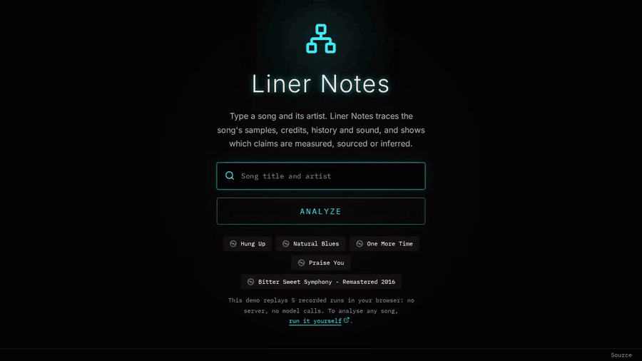

<div align="center">

# Liner Notes

**Type a song. Get its samples, credits and history, and see how every claim is known.**

An open-source AI agent for music research that keeps the model honest: measured values come from
the audio, relations come from primary records, and a verifier checks what the model writes against
the sources it cites.

[**Try the live demo**](https://josefdc.github.io/liner-notes/) ·
[How it works](#how-it-works) ·
[Evaluation](docs/evaluation.md) ·
[Known limitations](docs/limitations.md)

[](https://github.com/josefdc/liner-notes/actions/workflows/ci.yml)
[](LICENSE)
[](docs/development.md)
[](services/audio/README.md)



</div>

## Why

Ask a chatbot where a song's hook comes from and you get a fluent answer with no way to tell a
documented sample from a guess. A good model is often right: in
[the evaluation](docs/evaluation.md#the-agent), one with no tools found 11 of 16 known links, and 11
of the 12 it proposed were correct. But none of its 70 claims could be shown as sourced, because it
had nothing to cite. You cannot tell the right answers from the wrong one.

Liner Notes treats that as the problem to solve. Every value on the page carries how it is known:

| label | meaning | example |
| --- | --- | --- |
| **measured** | computed by the audio service from the track's 30 s preview | tempo 122.9 BPM, loudness -14.5 dBFS RMS |
| **sourced** | stated by a record or excerpt the page cites, and checked against it | "One More Time" samples "More Spell on You" by Eddie Johns (MusicBrainz) |
| **inferred** | written or estimated by a model and not backed by what it cites | a possible relation, the audio models' mood and style scores |
| **missing** | not known, with the reason | "Key not measured: the pitch had no steady notes" |

## Try it

**In your browser:** the [live demo](https://josefdc.github.io/liner-notes/) replays five recorded
runs. No server, no account, no model calls.

**On your machine, with no API keys** (Node.js 24+ and npm 11.18+):

```bash
git clone https://github.com/josefdc/liner-notes.git && cd liner-notes
npm ci
DEV_SERVICES=web,api REPLAY_MODE=only npm run dev   # then open http://localhost:3000
```

**On any song:** live analysis needs your own Spotify and Azure OpenAI keys, and optionally the other
sources. See [Development](docs/development.md).

## What you get

| Dashboard | Player |
| --- | --- |
|  |  |


- **A song-relations map.** Samples, covers and remixes on a timeline. Links stated by a record are
  built by code. A link a model proposed is drawn as a sample or cover only when its claim was found
  supported, and as an inferred influence otherwise.
- **Notes that cite their evidence.** The composer writes from an evidence pack, and has no field
  for a measured value.
- **Measured audio.** Tempo and loudness from Essentia, on the track's preview. A key is withheld
  unless the pitch is clear, which is rare.
- **The run in the open.** A live log of each step, and the date and commit of every recording.

## How well it works

From the [golden run](docs/evaluation.md#the-agent) of 2026-10-31 (24 tracks) and its set of 81
perturbed claims, with 95 % intervals. The [reports and run records](evals/reports/) are in this
repository.

| what | result |
| --- | --- |
| Claims shown as sourced | 84.1 % (232/276) [79.3, 87.9] |
| Verifier catches a mutated claim | 98.1 % (53/54) [90.2, 99.7] |
| Verifier rejects a supported claim | 0 % (0/27) [0.0, 12.5] |
| Hallucinated samples, on 5 tracks with none | 0 of 5 |
| Latency, median | 23.4 s |
| Cost per analysis, mean | USD 0.0102 |

And what does not work as well:

- **The verifier costs recall.** Edge recall fell from 87.5 % to 50 % (n = 16) while precision rose
  from 70 % to 80 %. The intervals overlap, so neither change is established.
- **Identity misses.** 70.8 % (17/24) of tracks resolved to the row's own recording.
- **Keys are almost never served.** 0 of 24 on the golden set, by design: the service withholds a
  key without clear, steady pitch.
- **Tempo is modest on hard datasets.** Acc1 53 % on Ballroom and 23.2 % on GiantSteps Tempo, from
  one 30 s window per clip, counting withheld values as wrong.

The showcase tracks were [chosen by a rule](docs/evaluation.md#the-showcase), so they show runs that
went well; the figures above cover every row. The full list is in
[Known limitations](docs/limitations.md), and [failure cases](docs/failures.md) replays some of them.

## How it works

```mermaid
flowchart LR
  browser["Browser<br/>React app"] -->|"/api, server-sent events"| caddy["Caddy<br/>(web image)"]
  caddy --> api["API<br/>Express 5"]
  api --> graph
  subgraph graph["LangGraph run"]
    direction LR
    scout --> clarification{"track picker<br/>(when unsure)"}
    scout --> engineer
    scout --> historian
    clarification --> engineer
    clarification --> historian
    engineer --> composer
    historian --> composer
    composer --> verifier
  end
  scout -.-> spotify["Spotify<br/>search, metadata"]
  engineer -.-> deezer["Deezer<br/>preview clip"]
  engineer -.-> audio["Audio service<br/>FastAPI, Essentia"]
  historian -.-> records["MusicBrainz, Discogs, SecondHandSongs,<br/>Genius, ListenBrainz, Last.fm, Tavily"]
  composer -.-> llm["Azure OpenAI<br/>research planner, composer,<br/>judge, More facts"]
  historian -.->|research planner| llm
  verifier -.-> llm
  api -.->|More facts| llm
  api --- db[("SQLite<br/>runs, caches,<br/>checkpoints")]
  api --- replays[("fixtures/replays<br/>recorded runs")]
```

- **scout** finds the track on Spotify; when the match is not clear it stops at the **track
  picker** and waits for the visitor's choice.
- **engineer** finds the Deezer preview of the recording (by its ISRC, else a strict search
  match) and sends it to the audio service, which returns the measured block (or why it measured nothing).
- **historian** resolves the recording on MusicBrainz and gathers primary records and search
  excerpts into the run's evidence pack; a model call (the fast tier's research planner) picks
  its follow-up steps, and code builds the sourced claims and links from it.
- **composer** writes the notes from the evidence; it has no field for a measured value.
- **verifier** checks every claim (deterministic checks, the numeric check, one judge call),
  sets each claim's kind, writes the measurement in and completes the run
  ([`docs/design.md`](docs/design.md#the-verifier)).
- **More facts** in the Player is a route of its own, outside the graph (`/api/factoids/more`
  and its stream): one model call per focus on the main tier, then the judge checks the facts it
  returns (`apps/api/src/factoids/service.ts`).
- Results are stored in SQLite and served again by run or by track; recorded runs are replayed
  with `REPLAY_MODE`. In deployment, Caddy serves the built web app and forwards `/api` to the
  API, and only the API reaches the audio service.

The reasoning, and what was rejected, is in [the design notes](docs/design.md).

## Tech stack and sources

| layer | stack |
| --- | --- |
| Web app | React 19, TypeScript, Vite, Tailwind CSS v4; the map drawn with `d3-selection`, `d3-zoom`, `d3-drag` and `d3-transition`; Recharts for the fingerprint chart; Lucide icons; self-hosted Inter and IBM Plex Mono |
| API | Node.js 24, Express 5, LangGraph 1.5, zod (the shared contract in `packages/contract`), SQLite through `better-sqlite3` |
| Models | Azure OpenAI through the API's provider layer (`apps/api/src/llm`), with a shared spend log and budget caps; the composer and the judge on different deployments by default |
| Audio service | Python 3.12, FastAPI; Essentia (`RhythmExtractor2013` and `KeyExtractor`) by default, librosa as the fallback; Essentia's TensorFlow models for the style and mood scores |
| Deployment | Docker Compose, Caddy, Cloudflare Turnstile (`deploy/`) |
| Tooling | npm workspaces, uv, Biome, ruff, Vitest, pytest, Playwright |

Sources, each read by the API (`apps/api/src/sources`), under the terms listed in
[NOTICE](NOTICE):

| source | what it gives |
| --- | --- |
| MusicBrainz | the recording, its releases, works and relations (samples, covers, remixes) |
| Cover Art Archive | the front cover of the release MusicBrainz names |
| Deezer | the 30 s preview the audio service measures, found by ISRC |
| Spotify | search, track metadata, cover images, and the preview clips of related tracks that the map plays, credited in the Player. Spotify's audio is no longer analysed (see "Old runs measured on Spotify's clip") |
| Last.fm | genre tags and similar tracks |
| Genius | song relationships (samples, covers, remixes); never lyrics |
| ListenBrainz | similar artists, from listening sessions |
| SecondHandSongs | originals and covers of the song (needs `SHS_API_KEY`, see above) |
| Discogs | release credits (needs `DISCOGS_TOKEN`) |
| Tavily | web search excerpts, cited as evidence |

## Documentation

| | |
| --- | --- |
| [Development](docs/development.md) | setup, every setting, and the checks CI runs |
| [Evaluation](docs/evaluation.md) | datasets, every figure, how the showcase is chosen |
| [Design notes](docs/design.md) | the evidence model, the verifier, the alternatives rejected |
| [Known limitations](docs/limitations.md) and [failure cases](docs/failures.md) | what goes wrong, with replays |
| [Deployment](docs/deployment.md) and [runbook](deploy/RUNBOOK.md) | the full stack on your own server |
| [Static demo](docs/static-demo.md) | how the demo is built, and how to host your own |
| [Privacy](docs/privacy.md) | what is stored and for how long |
| [Contributing](CONTRIBUTING.md) and [security](SECURITY.md) | how to help, how to report a problem |

## Licence

Liner Notes is licensed under the GNU Affero General Public License v3.0 only ([LICENSE](LICENSE)).
Third-party software, data sources, datasets and model weights are listed in [NOTICE](NOTICE). Some
of the audio models' weights are for non-commercial use only (CC BY-NC-SA 4.0). Changes are recorded
in [CHANGELOG.md](CHANGELOG.md).

If Liner Notes is useful or interesting to you, a star helps other people find it.
