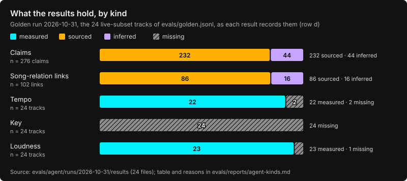

# Evaluation

Every figure below gives its dataset, n and a 95 % interval, and comes with a report and run records
in this repository, so it can be checked. Row-level records:
[`evals/agent/runs`](../evals/agent/runs/2026-10-31); reports: [`evals/reports`](../evals/reports/).

## What the results hold, by kind

Over the golden run (24 tracks, the live subset of `evals/golden.jsonl`; 2026-10-31, commit
`5fd193fa7a64`, tag `golden-run-2026-10-31`), by kind, as each result records it:

- Claims: 232 of 276 sourced (84.1 %, 95 % CI [79.3, 87.9]): 164 built by code from a record, 68
  written by the model and support-checked against their excerpts; 44 inferred. 3 of the
  inferred claims were found contradicted, and the page shows them only in its rejected panel.
- Song-relation links: 86 of 102 sourced (84.3 % [76.0, 90.1]), 16 inferred. One inferred link,
  whose claim was contradicted, is not drawn, so the maps show 101.
- Tempo: measured on 22 of 24 tracks (91.7 % [74.2, 97.7]); one track had no Deezer preview and
  one tempo was withheld as unsteady.
- **Key: never served on the golden set**: measured on 0 of 24 (0.0 % [0.0, 13.8]). The audio
  service withheld it on all 23 previews it analysed (19 for no sustained pitch, 2 as
  speech-like, 1 with too few pitch classes, 1 with one harmonic series); the 24th track had no
  preview. Why, in [Known limitations](limitations.md) ("Keys are rarely served").
- Loudness: measured on 23 of 24 (95.8 % [79.8, 99.3]); the 24th track had no preview.

Counts, intervals and reasons are in [`evals/reports/agent-kinds.md`](../evals/reports/agent-kinds.md),
written with the chart by `node evals/agent/kinds.mjs` from the committed run records (no
network, no model); `evals/agent/kinds.test.mjs` pins the counts.

## How figures are reported

Every figure gives its dataset, n and a 95 % interval (Wilson for proportions, a percentile
bootstrap over tracks for the agent's means, a BCa bootstrap for the MIREX key scores), with the
date and commit of the run. Rows with n < 10 are
counts only. The full reports, with how to read them, are in [`evals/reports/`](../evals/reports/).

### The agent

Dataset: the 24-row live subset of `evals/golden.jsonl` (45 rows; gold labels cite their
sources, none come from listening). Run 2026-10-31 at commit `5fd193fa7a64`, which is not in
`main`'s history (the branch was squashed) and is kept by the tag `golden-run-2026-10-31`.
Pipeline on `gpt-6-luna`, judge on `gpt-6-sol`. Report:
[`evals/reports/agent-2026-10-31.md`](../evals/reports/agent-2026-10-31.md); run records:
[`evals/agent/runs/2026-10-31`](../evals/agent/runs/2026-10-31).

What a page shows (row d, after the verifier):

| metric | dataset | value | n | 95 % CI |
| --- | --- | --- | --- | --- |
| preview coverage | golden live subset | 95.8 % (23/24) | 24 | [79.8 %, 99.3 %] |
| identity accuracy (recording level) | golden live subset | 70.8 % (17/24) | 24 | [50.8 %, 85.1 %] |
| clarification rate | golden live subset | 58.3 % (14/24) | 24 | [38.8 %, 75.5 %] |
| code-built edge coverage | golden live subset, gold edges | 43.8 % (7/16) | 16 | [23.1 %, 66.8 %] |
| pre-verifier support rate (model claims, row c; 14 not judged, counted as not supported) | golden live subset | 51.8 % (58/112) | 112 | [42.6 %, 60.8 %] |
| claims shown as sourced | golden live subset | 84.1 % (232/276) | 276 | [79.3 %, 87.9 %] |
| schema-valid rate | golden live subset | 100.0 % (24/24) | 24 | [86.2 %, 100.0 %] |
| fallback rate | golden live subset | 0.0 % (0/24) | 24 | [0.0 %, 13.8 %] |
| latency p50 | golden live subset | 23.4 s | 24 | [21.4 s, 25.0 s] |
| USD per analysis (mean) | golden live subset | USD 0.0102 | 24 | [USD 0.0092, USD 0.0113] |

Ablations, scored against the 16 gold edges of the same dataset (precision over the edges each
row proposed):

| row | what it runs | edge recall | edge precision | hallucinated samples (5 no-sample tracks) |
| --- | --- | --- | --- | --- |
| a | model only, no tools or evidence (`gpt-6-sol`) | 68.8 % (11/16) [44.4, 85.8] | 91.7 % (11/12) [64.6, 98.5] | 0/5 |
| b | code only, no model: retrieved edges | 43.8 % (7/16) [23.1, 66.8] | 7/8 (n < 10) | 0/5 |
| c | pipeline before the verifier: retrieved and proposed edges | 87.5 % (14/16) [64.0, 96.5] | 70.0 % (14/20) [48.1, 85.5] | 0/5 |
| d | pipeline after the verifier (what the page shows as documented) | 50.0 % (8/16) [28.0, 72.0] | 80.0 % (8/10) [49.0, 94.3] | 0/5 |

Row a runs on a different model from rows c and d, so it changes the model as well as the tools.
Its edges are the model's recollection: none is shown as sourced (0/70 claims, by construction:
it has no evidence to cite). The verifier trades recall for precision: from c to d, recall falls
from 14 to 8 of 16 and precision rises from 70.0 % to 80.0 %. The intervals overlap widely
(recall on 16 gold edges, precision on 20 and 10 proposed edges), so neither change is
established. Only one gold edge is held out from every source the pipeline queries, so held-out
recall is not reported as a rate.

The verifier as a classifier, on [`evals/perturb.jsonl`](../evals/perturb.jsonl) (81 claim cases:
27 claims supported by construction or by a deterministic check, and 54 mutations of them;
judge `gpt-6-sol`, recorded 2026-10-31 at `5fd193fa7a64`, tag `golden-run-2026-10-31`):

| metric | dataset | value | n | 95 % CI |
| --- | --- | --- | --- | --- |
| false-positive rate (supported claims rejected) | perturb set, positives | 0.0 % (0/27) | 27 | [0.0 %, 12.5 %] |
| catch rate (mutations rejected) | perturb set, mutations | 98.1 % (53/54) | 54 | [90.2 %, 99.7 %] |

The positives are never labelled by a verdict, and a mutation is unsupported by its excerpt,
which is not the same as false. There is one judge model (a judge from another family is not
available) and no agreement with human labels yet.

### The audio service

Tempo and key from the service as it serves them (its withholding rules included), with
Essentia, the default, and librosa, the fallback. A withheld value counts as not correct in
"correct / n". Acc1: within 4 % of the reference tempo; Acc2: also up to octave and meter
errors; MIREX: the weighted key score.

| dataset | n | estimator | answered | correct / n | correct / answered | run |
| --- | --- | --- | --- | --- | --- | --- |
| Ballroom, tempo | 200 | Essentia | 133/200 = 66.5 % [59.7, 72.7] | Acc1 106/200 = 53.0 % [46.1, 59.8]; Acc2 129/200 = 64.5 % [57.7, 70.8] | Acc1 106/133 = 79.7 % [72.1, 85.7] | 2026-10-29, `9682a4a` of #244 (merged as `4f194db`), analyzer 2.3.4 |
| Ballroom, tempo | 200 | librosa | 139/200 = 69.5 % [62.8, 75.5] | Acc1 109/200 = 54.5 % [47.6, 61.3]; Acc2 135/200 = 67.5 % [60.7, 73.6] | Acc1 109/139 = 78.4 % [70.9, 84.4] | 2026-10-29, `9682a4a` of #244 (merged as `4f194db`), analyzer 2.3.4 |
| GiantSteps+ Key | 250 | Essentia | 48/250 = 19.2 % [14.8, 24.5] | MIREX 38.8/250 = 15.5 % [11.6, 20.4]; exact 36/250 = 14.4 % [10.6, 19.3] | MIREX 38.8/48 = 80.8 % [69.6, 89.2] | 2026-10-29, `2901b7f` of #256 (merged as `2cf712e`), analyzer 2.3.4 |
| GiantSteps+ Key | 250 | librosa | 48/250 = 19.2 % [14.8, 24.5] | MIREX 35.8/250 = 14.3 % [10.6, 19.1]; exact 32/250 = 12.8 % [9.2, 17.5] | MIREX 35.8/48 = 74.6 % [62.9, 84.1] | 2026-10-29, `2901b7f` of #256 (merged as `2cf712e`), analyzer 2.3.4 |
| GiantSteps Tempo | 400 | Essentia | 156/400 = 39.0 % [34.3, 43.9] | Acc1 93/400 = 23.2 % [19.4, 27.6]; Acc2 129/400 = 32.2 % [27.9, 37.0] | Acc1 93/156 = 59.6 % [51.8, 67.0] | 2026-10-25, `78555ce` of #89 (merged as `28cdaaf`), analyzer 2.1.0 |
| GiantSteps Tempo | 400 | librosa | 216/400 = 54.0 % [49.1, 58.8] | Acc1 91/400 = 22.8 % [18.9, 27.1]; Acc2 128/400 = 32.0 % [27.6, 36.7] | Acc1 91/216 = 42.1 % [35.7, 48.8] | 2026-10-25, `78555ce` of #89 (merged as `28cdaaf`), analyzer 2.1.0 |

Reports: [`evals/reports/audio-2026-10-29.md`](../evals/reports/audio-2026-10-29.md) (Ballroom,
GiantSteps+ Key) and [`evals/reports/audio-2026-10-25.md`](../evals/reports/audio-2026-10-25.md)
(GiantSteps Tempo); the harness is in [`evals/audio`](../evals/audio/README.md). Their limits:

- **One 30 s window per clip**, the length of the previews the app measures, scored against
  labels for the whole excerpt, with ambiguous key labels left out. The figures cannot be
  compared with published ones for these datasets.
- **beat-this**, measured as a candidate and not shipped, was trained on Ballroom: its Ballroom
  figure (Acc1 148/200 = 74.0 % [67.5, 79.6]) is on its own training data. On GiantSteps Tempo
  it had Acc1 109/400 = 27.3 % [23.1, 31.8]. Both are in the 2026-10-25 report
  (`docs/design.md`, "Alternatives that were rejected").
- **Analyzer versions**: the service is now at 2.3.6. A controls run at 2.3.6 gave the same
  outputs as at 2.3.4 (`evals/audio/README.md`; the run is
  `evals/reports/audio-2026-10-30.md`); GiantSteps Tempo was last measured at 2.1.0.
- The audio is commercial excerpts, fetched for evaluation only and never committed; the
  annotations' licences are in [NOTICE](../NOTICE).

## The showcase

Five tracks are served from recorded runs (`fixtures/replays`) whenever live analysis is off or
unavailable: One More Time (Daft Punk), Bitter Sweet Symphony (The Verve), Hung Up (Madonna),
Praise You (Fatboy Slim) and Natural Blues (Moby). A replayed page says "Recorded run", with the
date and commit it was recorded at.

They were not picked by hand. `node evals/agent/showcase.mjs` chooses them from the golden run's
records (below) by a rule, and `evals/agent/showcase.test.mjs` checks that the committed
recordings are its choice. A row is eligible when the run resolved the row's own recording,
measured a tempo from the signal, has the Cover Art Archive's front image of the release its
MusicBrainz record names, copied no measured field from model text and showed no model claim as
sourced without the judge's verdict, has at least 5 code-built sourced links on its map, has a
MusicBrainz genre, and shows no claim whose relation is named "Possible …". The eligible rows
that were showcases before are kept, then the eligible rows of a style not yet chosen are added,
most code-built links first (ties by ISRC order), until there are at least 5 tracks and 4 styles.

- 7 of the 24 golden-run rows are eligible. Gangnam Style (PSY) tied with Natural Blues and
  Praise You at 8 code-built links and lost the tie on ISRC order; with those two the rule had
  five tracks of five styles and stopped. Running Up That Hill (Kate Bush) shares its style, pop,
  with Hung Up. Juicy, a showcase before this rule, is not eligible: its run resolved a later
  reissue ([failure cases](failures.md#identity-resolves-a-later-reissue-juicy)).
- The page rule alone leaves out **Gangsta's Paradise** (Coolio feat. L.V.) and **The Less I
  Know the Better** (Tame Impala): each page would show a relation as "Possible". For
  Gangsta's Paradise that relation is documented: the page would show "Possible sample" next to
  the sample its MusicBrainz record states. Leaving hedged relations out is a choice for the
  demonstration; other pages show them.

The showcase is a demonstration, not a sample of how the app does in general: the rule keeps the
runs that went well. The evaluation below covers every row.
